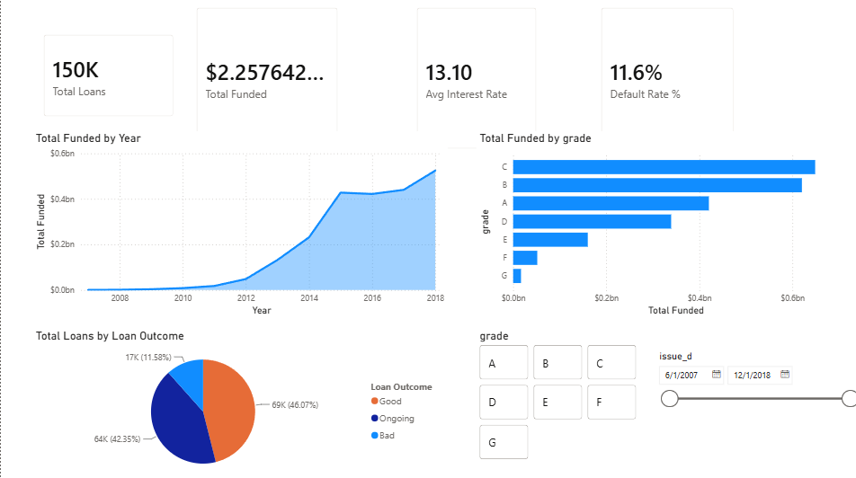
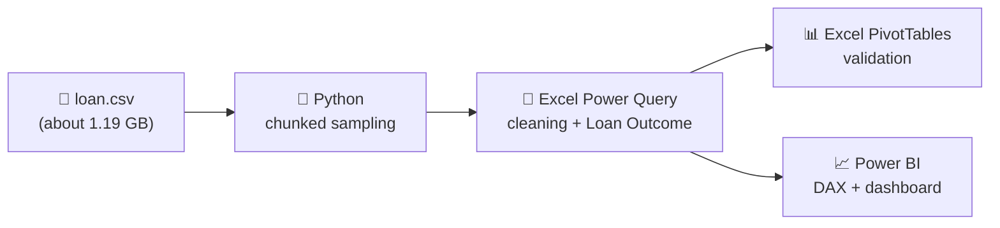

# 💳 LendingClub Credit Risk & Return Analysis


> **Do higher interest rates on risky loans actually make up for the extra defaults?**
> This project analyses **150,000 LendingClub loans (2007–2018)** to find out, using Python, Excel and Power BI.



---

## 📑 Table of Contents

1. [Project at a Glance](#-project-at-a-glance)
2. [Key Findings](#-key-findings)
3. [Dashboard Pages](#-dashboard-pages)
4. [How It Was Built](#-how-it-was-built)
5. [Repository Structure](#-repository-structure)
6. [Dataset](#-dataset)
7. [How to Use](#-how-to-use)
8. [Limitations](#-limitations)
9. [Author](#-author)

---

## 🎯 Project at a Glance

| Metric | Value |
|---|---|
| Loans analysed | **150,000** |
| Total funded | **$2.26 bn** |
| Average interest rate | **13.10%** |
| Overall default rate | **11.6%** |
| Defaulted exposure | **$0.27 bn** |
| Period covered | June 2007 – December 2018 |

**Tools:** Python (pandas) · Excel (Power Query, PivotTables) · Power BI (DAX, slicers)

---

## 🔍 Key Findings

### Risk and return by loan grade

| Grade | Avg. interest rate | Loans that defaulted¹ | Realised ROI² |
|:---:|:---:|:---:|:---:|
| **A** | 7.1% | 3.3% | 🟢 +5.3% |
| **B** | 10.7% | 7.7% | 🟢 +5.1% |
| **C** | 14.1% | 12.8% | 🟢 +2.4% |
| **D** | 18.1% | 18.4% | 🟡 +0.3% |
| **E** | 21.8% | 25.4% | 🔴 −0.3% |
| **F** | 25.4% | 33.9% | 🔴 −3.6% |
| **G** | 28.0% | 36.2% | 🔴 −8.1% |

<sub>¹ Share of **all** loans in the grade that ended as "Bad", including loans still ongoing.<br>
² ROI = (total payments received − amount funded) ÷ amount funded, calculated on **closed loans only** (Fully Paid or Charged Off).</sub>

### What this tells us

- ⬆️ **Risk rises with every grade.** Grade G loans default about **11 times** as often as grade A.
- 💸 **Higher rates don't pay for the extra risk.** Returns fall steadily and turn **negative from grade E onwards**.
- ⏳ **Longer loans are riskier.** 60-month loans have a 15.6% bad-loan share versus 10.0% for 36-month loans.
- ⚠️ **High-risk exposure is small but costly.** Grade F and G loans are 3,529 loans (**$0.07 bn, 3.0%** of total funding) with the weakest returns in the portfolio.

> 💡 **Note on the 11.6% default rate:** it is measured across *all* 150,000 loans, and about 42% of them are still ongoing. Among loans that have actually closed, the loss rate is about **20.1%**.

---

## 📊 Dashboard Pages

The Power BI report has four pages.

| 1️⃣ Overview | 2️⃣ Risk Analysis |
|:---:|:---:|
|  |  |
| Totals, funding trends by year and grade, loan outcome split | Default rate by grade, purpose and state; ROI by grade |

| 3️⃣ Borrower Profile | 4️⃣ Executive Risk Dashboard |
|:---:|:---:|
|  |  |
| Debt-to-income, income by grade, home ownership, with slicers | KPI cards for high-risk loans, high-risk exposure and defaulted exposure |

**Key measures (DAX):** Total Loans · Total Funded · Avg Interest Rate · Default Rate % · High Risk Loans · High Risk Exposure · High Risk Exposure % · Defaulted Exposure · ROI %

**How the main metrics are defined:**

| Metric | Definition |
|---|---|
| High risk | Loans graded **F or G** |
| Defaulted exposure | Amount funded on loans with outcome **Bad** |
| ROI % | (total payments − amount funded) ÷ amount funded, on closed loans |

---

## 🛠️ How It Was Built



### Step 1: Sample the data (Python)
`scripts/make_powerbi_csv.py` shrinks the huge raw file so it can be used in Power BI:
- Reads the file in **200,000-row chunks**, so memory is never overloaded
- Keeps **18 relevant columns** and warns if any expected column is missing
- Drops rows with no `loan_status`
- Takes a reproducible **random sample of 150,000 rows** (`random_state=42`)

### Step 2: Clean the data (Excel Power Query)
- Trimmed text and converted `term`, `int_rate` and `issue_d` to proper types
- Converted employment length to a number (`emp_years`: 0 = under 1 year, 10 = 10+ years)
- Created a **Loan Outcome** column:

| Loan Outcome | Loan status values included |
|---|---|
| ✅ **Good** | Fully Paid |
| ❌ **Bad** | Charged Off, Default |
| ⏳ **Ongoing** | Current, In Grace Period, Late (16–30 and 31–120 days), "Does not meet the credit policy" statuses |

### Step 3: Validate (Excel PivotTables)
Pivots of outcome mix by grade, average rate and loan size by grade, and loan count by purpose were used to cross-check the dashboard numbers.

### Step 4: Visualise (Power BI)
The cleaned table feeds a four-page interactive dashboard with slicers for grade, issue date, employment length, income verification and home ownership.

---

## 📂 Repository Structure

```
├── dashboard/
│   └── LendingClub_Risk_Return_Analysis.pbix    Power BI report
├── excel/
│   ├── LCDataDictionary.xlsx                    Field definitions
│   └── loansmanualclean.xlsx                    Cleaned 150k sample + pivots
├── screenshots/                                 Dashboard, Power Query and pivot images
├── scripts/
│   └── make_powerbi_csv.py                      Sampling script
└── README.md
```

---

## 🗃️ Dataset

The cleaned sample has **19 columns**:

| Group | Columns |
|---|---|
| Loan details | `loan_amnt`, `funded_amnt`, `term`, `int_rate`, `installment`, `grade`, `sub_grade`, `purpose`, `issue_d` |
| Borrower | `emp_years`, `home_ownership`, `annual_inc`, `verification_status`, `addr_state`, `dti` |
| Outcome | `loan_status`, `total_pymnt`, `recoveries`, `Loan Outcome` *(derived)* |

Full field descriptions are in `excel/LCDataDictionary.xlsx`. The original `loan.csv` is **not** included because of its size.

---

## 🚀 How to Use

**Just view the results**
Open `dashboard/LendingClub_Risk_Return_Analysis.pbix` in **Power BI Desktop** (Windows). The data is already inside the file.

**Rebuild the sample yourself**
1. Download the LendingClub `loan.csv` and place it next to `LCDataDictionary.xlsx`.
2. Open `scripts/make_powerbi_csv.py` and change the `FOLDER` path at the top to your own folder.
3. Run:
   ```bash
   pip install pandas openpyxl
   python scripts/make_powerbi_csv.py
   ```
4. Load the output `loans_clean.csv` into Excel Power Query, apply the cleaning steps above, then connect Power BI.

---

## ⚠️ Limitations

- **Unfinished loans:** about 42% of loans are still ongoing, so the "Bad" share understates eventual losses, especially for 2016–2018 loans.
- **Broad "Ongoing" group:** late and grace-period loans sit with current loans, and 182 loans with a "Does not meet the credit policy" status are placed in Ongoing even if they were paid or charged off.
- **Simple ROI:** it is not annualised or time-weighted and ignores fees and taxes.
- **Sample, not full data:** results come from a 150,000-row random sample.
- **Tiny categories:** purposes like `educational` (19 loans) and `renewable_energy` (92 loans) are too small to draw conclusions from.

---

## 👤 Author

**Shivi Gupta**
[LinkedIn](https://linkedin.com/in/shivi-gupta-6271a8371) · [GitHub](https://github.com/Shivigupta0899)

⭐ If you found this project useful, consider giving it a star!
